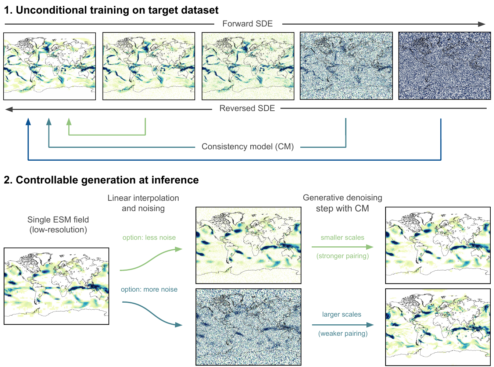

# Generative climate model downscaling

## Overview

This is the repository of the [paper](https://www.nature.com/articles/s42256-025-00980-5) "Fast, scale-adaptive and uncertainty-aware downscaling of Earth system model fields with generative machine learning".



## Usage
Set paths to training data and hyperparameters in `src/configuration.py`. Some can be changed via the shell when executing the training run with:

```bash
python main.py \
    --name "my_model" \
    --n_epochs 50 \
    --batch_size 8 
```

## Preprocessing

### Download

The ERA5 training data can be downloaded [here](https://cds.climate.copernicus.eu/datasets/reanalysis-era5-single-levels?tab=download). The data is in hourly resolution and needs to be downloaded in individual files. 

### Data processing
For merging the files and computing the daily mean, I recommend using the [Climate Data Operators](https://code.mpimet.mpg.de/projects/cdo). The files can then be merged using

```bash
cdo mergetime era5_hourly_* era5_hourly_merged.nc
```

The daily mean can be computed using

```bash
cdo daymean -shifttime,-1hour era5_hourly_merged.nc era5_daily_merged.nc

```

### Regridding

In order to regrid the ERA5 data from the native resolution to the target resolution used in the paper use the regridding function implemented [here](src/utils/xarray_utils.py#L174-L193).


### Transformations

Other preprocessing steps such as transformations for standardization are implemeneted in the dataloader.


## Tests

Run unit tests with 

```bash
 python -m unittest discover tests/
```


## References
The implementation is mostly based on the repositories:

- https://github.com/yang-song/score_sde_pytorch 
- https://github.com/openai/consistency_models.

as well as the papers:

- Y. Song et at., 2021: https://arxiv.org/abs/2011.13456
- Y. Song et at., 2023: https://arxiv.org/abs/2303.01469
- Bischoff and Deck, 2023: https://arxiv.org/abs/2305.01822
- T. Karras et al., 2022: https://arxiv.org/abs/2206.00364

